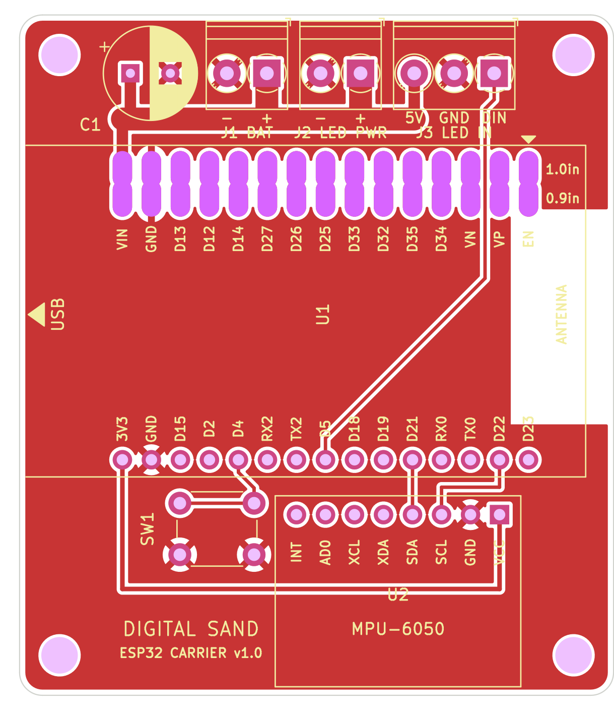
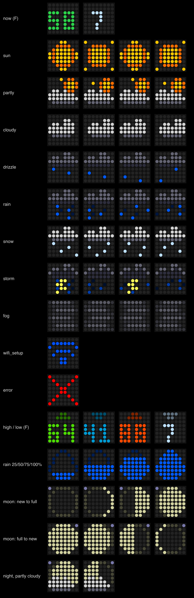
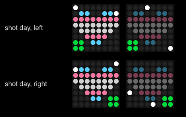

# Evil Weather Machine

A carrier PCB and new firmware for the [PrintKits Digital Sand kit](https://printkits.com/blogs/instructions/digital-sand):
an ESP32 DevKit, a GY-521 accelerometer, an 8x8 WS2812B panel and a 4xAA box in a printed cube.

| | |
|---|---|
| [`pcb/`](pcb/) | KiCad 7 two-layer board (52 × 59.5 mm) that replaces the kit's point-to-point wiring, with Gerbers ready to order |
| [`firmware/weather/`](firmware/weather/) | ESP32 firmware: today's weather plus an injection-day reminder, with WiFi setup from a phone and updates over WiFi |



## Firmware

The panel flips through today's high and low temperature, an animated weather icon and the chance of rain.
On injection days it adds a beating trans-flag heart, with a green dot in the corner for the side to use.



### Shot day 💉🏳️‍⚧️

It's E day, babe! Every third day the cube reminds you it's time for your estrogen shot. Sides
alternate left and right on your belly, which works out to exactly ten shots in any 30 days, so
your levels stay nice and steady.

On shot day a little extra screen slips into the rotation: a heart in the trans flag's blue, pink
and white, beating and sparkling. A green dot in the bottom-left or bottom-right corner tells you
which side it's for. On the other days it stays quiet and just does the weather, so it only shows
up when it matters.



There's nothing to log or tap. You know when you've done it, and the cube just keeps the calendar.
It counts forward in 3-day steps from one shot you set in
[`config.h`](firmware/weather/src/config.h) (`LAST_SHOT_*`: the date and the side), flipping sides
each time. If a shot runs a day late and your rhythm shifts, set those to your latest shot and push
an update over WiFi. It gets the date from the internet, and once it's been online it keeps counting
even when the WiFi doesn't. 💖

Quick start, with [PlatformIO](https://platformio.org/) installed:

```bash
cd firmware/weather
pio run -t upload          # first time, over USB
pio run -e ota -t upload   # after that, over WiFi
```

On first boot, join the `DigitalSand-Weather` WiFi network from a phone to connect the toy to your WiFi.
Settings (units, panel orientation, shot schedule) are in
[`firmware/weather/src/config.h`](firmware/weather/src/config.h). See the
[firmware README](firmware/weather/README.md) for details.

## PCB

The board carries the ESP32 (either 0.9 in or 1.0 in header spacing), the GY-521, the button and screw
terminals for the battery and the LED panel. It's generated by
[`pcb/tools/generate_kicad.py`](pcb/tools/generate_kicad.py); see the [PCB README](pcb/README.md) for
assembly notes and what to check before ordering. The board hasn't been fabricated yet.

## Tools

- KiCad 7, used through its bundled Python for the PCB generator.
- PlatformIO with `espressif32@6.4.0` for the firmware.
- `rsvg-convert` (librsvg) for the preview images.
