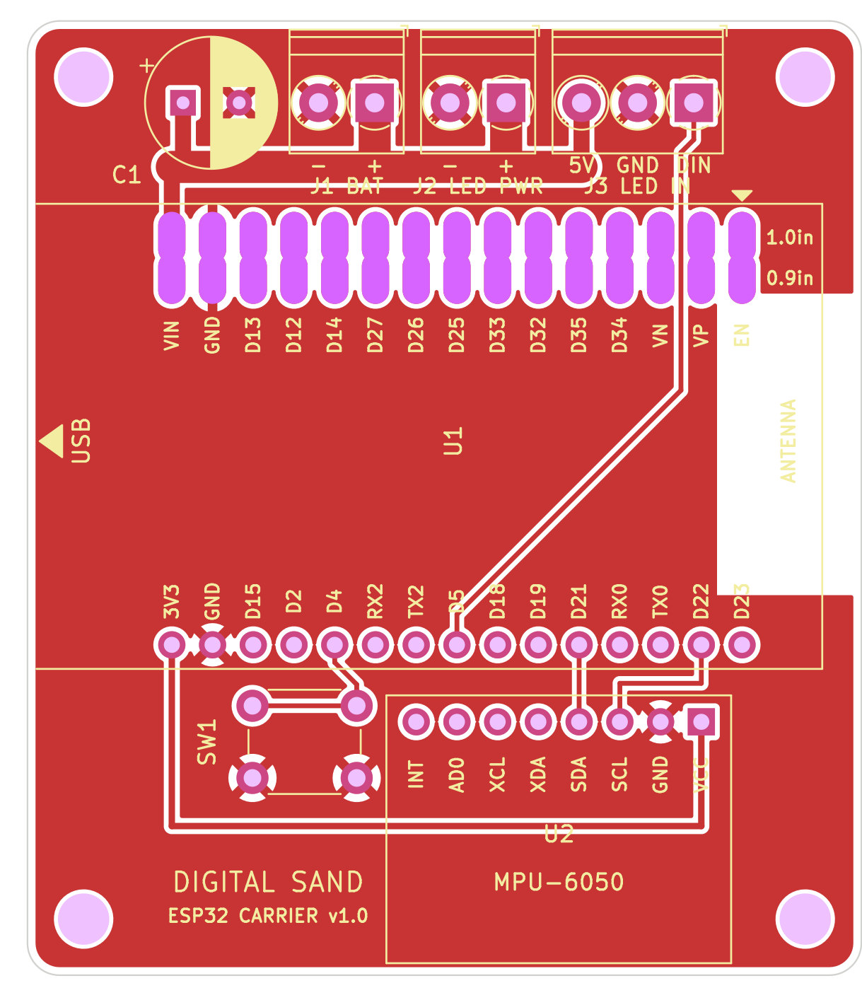
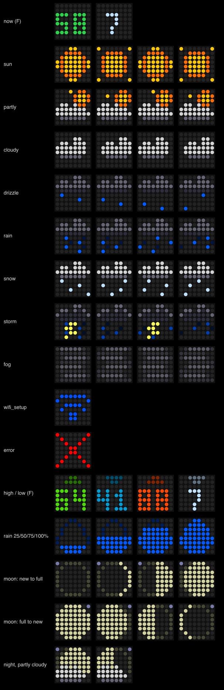
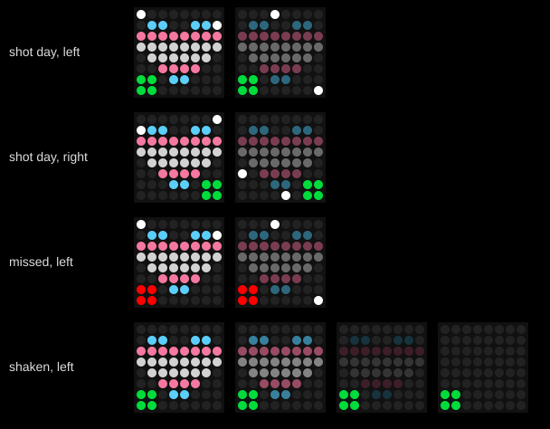

# Evil Weather Machine

A carrier PCB and new firmware for the [PrintKits Digital Sand kit](https://printkits.com/blogs/instructions/digital-sand):
an ESP32 DevKit, a GY-521 accelerometer, an 8x8 WS2812B panel and a 4xAA box in a printed cube.

| | |
|---|---|
| [`pcb/`](pcb/) | KiCad 7 two-layer board (52 × 59.5 mm) that replaces the kit's point-to-point wiring, with Gerbers ready to order |
| [`firmware/weather/`](firmware/weather/) | ESP32 firmware: today's weather plus an injection-day reminder, with WiFi setup from a phone and updates over WiFi |



## Firmware

The panel flips through the current temperature, an animated icon for the weather right now (the moon in
its current phase at night), today's high and low, and the chance of rain when rain is likely in the next
12 hours. On injection days it adds a beating trans-flag heart, with a green dot in the corner for the
side to use. Shaking the toy records the injection; a missed one turns the dot red and takes over the
display.



### Shot day

A reminder for injectable estradiol (HRT).

**Schedule**
- One injection every 3 days: 10 injections in any 30-day window.
- The site alternates between the left and right side of the abdomen.
- Shot days are calculated from the calendar. A late injection does not move the next one.
- The device stores one record: the date of the last scheduled injection recorded as taken.

**Display**
- On a shot day, one extra screen is added to the rotation, after the rain chance.
- It shows a heart in trans flag colours (blue, pink, white), beating, with white sparkle pixels around it.
- A green 2×2 dot in the bottom-left or bottom-right corner marks the injection side: left or right.
- Shaking the toy records the injection as taken that day. The heart fades out and the screen is
  removed from the rotation.
- If the shot day ends without a shake, the injection is marked missed. The heart becomes the only
  screen and the dot turns red, until a shake records the injection or the next shot day starts.
- On other days the screen is not shown.



**Configuration** ([`config.h`](firmware/weather/src/config.h))
- `LAST_SHOT_YEAR`, `LAST_SHOT_MONTH`, `LAST_SHOT_DAY`: the date of one injection to count from.
  Changing these values clears the stored record.
- `LAST_SHOT_SIDE`: the side of that injection, `'L'` or `'R'`.
- `SHOT_EVERY_DAYS`: the interval, 3 by default.
- `SHAKE_G`, `SHAKE_JOLTS`, `SHAKE_WINDOW_MS`: what counts as a shake (4 jolts above 2 g within 1.5 s).

**Timekeeping**
- The date comes from internet time (NTP), in the local timezone reported by the weather service.
- After the first successful connection, the timezone is stored and the count continues without WiFi.
  Internet time is still needed after each power cycle.

Quick start, with [PlatformIO](https://platformio.org/) installed:

```bash
cd firmware/weather
pio run -t upload          # first time, over USB
pio run -e ota -t upload   # after that, over WiFi
```

On first boot, join the `DigitalSand-Weather` WiFi network from a phone to connect the toy to your WiFi.
Settings (units, panel orientation, shot schedule) are in
[`firmware/weather/src/config.h`](firmware/weather/src/config.h). See the
[firmware README](firmware/weather/README.md) for details.

## PCB

The board carries the ESP32 (either 0.9 in or 1.0 in header spacing), the GY-521, the button and screw
terminals for the battery and the LED panel. It's generated by
[`pcb/tools/generate_kicad.py`](pcb/tools/generate_kicad.py); see the [PCB README](pcb/README.md) for
assembly notes and what to check before ordering. The board hasn't been fabricated yet.

## Tools

- KiCad 7, used through its bundled Python for the PCB generator.
- PlatformIO with `espressif32@6.4.0` for the firmware.
- `rsvg-convert` (librsvg) for the preview images.
